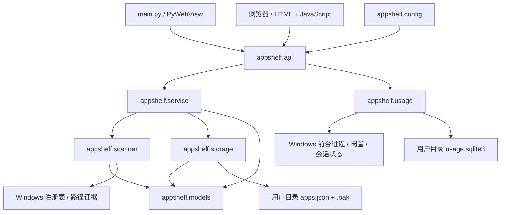

# AppShelf 架构说明

## 目标与边界

保留 Python、网页界面与 PyWebView。通过模块边界和统一事务解决扫描、编辑相互覆盖的问题，并把程序资源与用户数据分开。当前面向本机单用户使用，不引入前端构建工具、独立数据库服务或网络账户系统。

## 模块职责

| 模块 | 负责 | 不负责 |
|---|---|---|
| `api.py` | 本机 HTTP、请求来源和会话令牌、JSON 格式、资源白名单、扫描与采集生命周期 | 不直接读写 JSON，不在请求处理器内实现编辑规则 |
| `service.py` | 编辑校验后的应用操作、状态确认、扫描结果合并、显式测量 | 不解析 HTTP，不自行覆盖清单文件 |
| `scanner.py` | 注册表记录采集、安装身份、根据清单和证据计算差异 | 不修改清单，不写文件，不递归测量目录 |
| `discovery.py` | 快捷方式、有限软件目录中的便携副本、可执行文件版本和位数 | 不执行被扫描的程序，不扫描网络共享 |
| `metadata.py` | 已知产品的用途、分类、官网，以及可用安装信息的补缺 | 不编造未知软件的用途，不覆盖人工介绍 |
| `usage.py` | Win32 前台采样、闲置和睡眠判断、SQLite 区间、日周月汇总 | 不保存窗口标题或输入内容，不改应用清单，不补算未采集历史 |
| `storage.py` | 读改写事务、锁、备份、原子替换、清单版本、显式导入 | 不扫描注册表，不决定应用是否卸载 |
| `models.py` | 字段校验、规范路径、旧字段兼容、条目迁移 | 不发送请求，不启动后台任务 |
| `config.py` | 程序资源根目录、用户数据目录 | 不创建服务，不解析命令行 |

`server.py` 只处理浏览器入口和命令行参数；`main.py` 创建同一套服务并交给桌面窗口。导入入口模块不会启动线程或解析宿主进程参数。本地 HTTP 的 `/` 默认提供 `home.html`，桌面窗口也从首页打开；`index.html` 仍是应用目录，`usage.html` 为使用时间。三个入口共用顶部导航和全局搜索。

## 页面职责与浏览状态

首页使用独立的 `home.html`、`assets/home.js`、`assets/home.css`，不需要 `home.py`。它提供应用目录、使用时间两个入口，展示实际收录应用与分类数、今日前台时间和最多 4 个常用应用。清单与 `GET /api/usage?period=day` 独立读取，任一数据源失败不会阻塞另一块内容。首页不发起扫描或修改数据，页面读取也不启动采集器；采集仍由程序生命周期管理。静态预览只有现有清单概览，时间部分显示说明，不生成替代记录。

共享 `assets/app.js` 在展示层计算相关条目，以同一 `group` 中的其他可见记录呈现「相关条目与位置」。相关组可以包含主程序、插件或不同版本，不能解释为副本数量，因此移除逐行的「N 份」徽标。QQ 与邮件插件这样的关联展开后分别显示名称、版本、位数和实际位置，不合并底层记录。历史 Logitech 条目误标为 `group=git` 的情况只在关联选择时排除，原始清单不重写。

从目录打开详情前，页面在浏览器历史状态及会话存储中保存原视图地址、搜索词、分类和位置筛选、滚动锚点与偏移，以及相关条目的展开状态。正常详情跳转记录来源标识，只有来源与当前历史状态相符时才调用 `history.back()`，使返回恢复同一段浏览过程。直接打开的深链接使用校验过的站内目录地址，无法校验时退回全部应用，避免无条件后退到无关页面。恢复滚动时优先使用条目锚点，缺少锚点时回到保存的滚动位置；分类侧栏的展开和滚动状态独立保留。

相关回归测试分别位于 `tests/home.cjs`、`tests/related.cjs`、`tests/navigation.cjs`，可通过 `node` 直接运行。

## 编辑流程

1. 页面从 `/api/session` 获得当前服务的会话令牌，从 `/api/apps` 获得清单与版本。
2. 编辑窗口保留打开时的版本。保存时提交条目 ID、修改字段和该版本。
3. HTTP 层验证本机来源、令牌、JSON 内容和请求大小。
4. 应用层校验字段，存储层取得进程内锁与跨进程文件锁，读取当前清单并比较版本。
5. 版本一致时应用修改、备份上一份有效清单、刷新临时文件并替换；版本不一致时返回 HTTP 409，原清单不变。

两个窗口同时基于旧版本保存时，后到的请求需要刷新后重做修改。系统不会把第二个请求伪装为保存成功，也不会把旧清单覆盖到磁盘。

编辑器的 `source` 和 `size` 始终只读，不在提交中发送；原条目为 `source=bundled` 时，`installDate` 也只读且不提交。后端在同一事务内再次按原条目检查，拒绝改动或清空这些字段，兼容旧客户端回传相同值。系统日期的已有值继续展示，无证据时保持未知。普通应用日期仍可编辑，修改后标记 `dateSource=manual`。扫描只补缺失的有效日历日期及其来源，不覆盖已知日期，不使用文件时间伪造安装日期。

## 扫描流程

1. 扫描先采集完整注册表快照。部分键无权限、枚举中途失败或平台不支持时，返回明确错误，避免把不完整快照解释为软件被卸载。
2. 取得存储事务后，读取**此时最新的清单**，调用 `scan_diff` 计算新发现、移除、恢复、不确定项和身份匹配。
3. 应用层将差异合并到该清单。已有名称、介绍、分类和人工分组保留，只更新匹配身份和扫描状态，并新增真正的新安装记录。
4. 保存后更新扫描状态；页面检测到版本变化时提示刷新，保留当前浏览和编辑内容。

`registryId` 由注册表 hive、视图与卸载子键构成，同一键的显示名称或版本改变不会产生新的安装身份。旧条目只有在完整名称和安装位置能够安全对应时，才建立一对一匹配。名字相近不能视为同一软件，版本号也不会被统一剥除。

移除判断需要同时缺少注册表记录和所有可用本地路径。盘符断开、权限不足和网络共享不可探测时保留不确定状态；便携或人工记录不能仅凭路径消失判为已卸载。扫描不自动访问 UNC 网络共享，也不遍历目录计算大小。记录或有效路径重新出现时，原先的缺失状态可以恢复。

自动扫描在启动时运行，之后间隔 30 分钟。`--no-scan` 关闭自动调度；手动扫描仍走相同应用层和存储事务。

扫描也会补读发布者、版本、注册表报告的估计占用，以及桌面和开始菜单快捷方式。快捷方式可补全注册表没有提供的安装路径。对于已知可执行文件，在软件目录中最多检查三层目录、共 30,000 个目录项，并检查下载、桌面、临时目录顶层；不把安装缓存图标的位置当作软件安装目录。此范围以外、既没有卸载记录也没有快捷方式的便携软件仍可能需要手动收录。

便携副本使用规范化后的真实文件路径作为安装身份；同一软件在不同位置、32 位和 64 位副本会分别保留。Windows 短路径与长路径解析为同一真实路径。`catalogue.py` 在读取快照时添加 `duplicateOf` 和 `availability` 展示注解：同一产品、同一实际路径且版本/架构相容的重复记录指向确定的主项，优先保留人工完善条目。注解不进入底层 JSON，原始 ID、描述和来源记录不删除。旧重复链接指向主项，真实副本不折叠。

界面隐藏 `removed`、`missing`、`duplicateOf` 及 `availability=absent`，底层记录保留；目录、关联条目、搜索、分类计数和首页统一规则。有限的已知本地路径证据使用短期缓存，权限错误、断盘和网络位置保持 unknown，不能当作缺失。扫描拒绝明确缺失的新发现，真实重新出现后恢复记录。全局搜索固定在所有页面顶部；从分类页搜索会回到全部应用并取消位置筛选，详情页提供跨分类的搜索结果和查看全部入口。

## 数据与迁移

程序文件与用户数据目录相互独立。默认用户目录是 `%LOCALAPPDATA%\AppShelf`，可通过 `APPSHELF_DATA_DIR` 或优先级更高的 `--data-dir` 覆盖。

新目录创建空 `apps.json`；仓库内的旧快照不会自动复制进去。`--import` 只允许导入空清单，转换路径结构并保持源文件不变。原有 `data/apps.json` 继续用于静态预览和人工选择的导入。

`paths` 是路径事实的规范来源：每项有 `path`、`kind`、`note`。旧 `path` 字符串仍可读取，保存时也会生成兼容展示字段。说明文本不再混进传给文件系统的实际路径。

存储只保留一份上一次有效内容的 `.bak`。坏文件不会自动改为空清单；应先停止所有使用同一数据目录的进程，保留故障文件，再检查备份后恢复。

## 使用时间流程

`main.py` 和 `server.py` 显式调用 `start_recording()`，默认用 `background.py` 管理独立隐藏进程。主界面关闭只停止本窗口的采集器及 HTTP 服务，后台继续写入同一个 SQLite。导入模块或仅调用 `create_server()` 不启动后台或写登录启动项。后台失败或用户停用后台时，窗口采集器作为临时回退；同一目录的 `usage.collector.lock` 防止重叠采集。

独立 `--usage-worker` 入口在构造 HTTP 或导入 WebView 前分流，只创建 UsageTracker。`background.json` 的 enabled/generation 决定存活；独立 worker 锁保证单例，配置锁串行调整。停用后 worker 自己退出，不按 PID 杀进程，不删历史；超时启动通过更新 generation 撤销，防止迟到进程复活。后台每秒发布真实采集状态，API 将其合并到统计返回值，保留数据库 since。心跳过期报告异常。

Windows 登录自启使用当前用户 Run 键，名称为数据目录的稳定哈希，命令引用冻结可执行文件或源代码 pythonw/main.py。命令按 Windows 规则转义，长度超限或注册表失败必须报告；不需要系统服务和管理员账户。默认启用，前端可关闭。`--no-background` 仅影响本次启动，`--disable-background` 无窗口停用指定数据目录。

`usage.html` 与 `assets/usage.js`、`assets/usage.css` 负责周期选择、精简统计条、日周月图表、排行、采集状态及后台开关。排行行使用原生链接；已知软件以目录 ID 导航，未收录的使用 usageId 经只读 `/api/usage/app?id=…` 获取实际名称、路径、版本及累计记录，不自动修改清单。统一详情返回协议保留统计周期、日期与位置；首页常用同样支持未收录条目。

图表使用前端 `chart=line|bar` 参数，默认折线，切换不改变后端请求和统计值。实际零值参与折线，未来桶不绘制点或连线；只用线性线段，避免曲线平滑产生虚构峰值。已有浮层、键盘操作、日期与图表类型的返回恢复共用原导航协议。

品牌图像只显式开放 `assets/appshelf.png` 和 `assets/appshelf.ico`，返回对应二进制 MIME，不放开其他图片、目录或用户文件。PyInstaller 的 icon 与 PyWebView.start(icon=…) 均引用同一 ICO，静态页面和共享导航引用同组素材。

`quotes.py` 保存用户确认的 100 条原创语录，在服务创建时用 SQLite 事务从持久化随机队列中取一句。独立 `preferences.sqlite3` 保存剩余队列与上次选择；每轮无重复，轮次边界避免相邻重复，多实例事务串行。`/api/session` 返回本次固定语录，刷新、导航或跨日不再随机。偏好文件损坏时保留原文件并降级为本次随机语录，不影响清单和时间历史。

`poems.py` 从内置 `data/poems.json` 加载 1000 条古诗联句，利用同一个随机队列实现，以 `home-poems` 和 `time-quotes` 两个键隔离。新版偏好存储内容指纹而不是复制整个候选池，并兼容既有时间语录的 `pool` 字段。首页通过会话响应中的 `poem` 读取当前诗句，独立于目录和计时请求。静态模式可读取明确开放的公开诗库 `/data/poems.json`，不扩大为任意 JSON 文件访问。出处、整理规则与上游许可证见 `poetry.md`。

`icons.py` 使用 Windows 图标资源提取与 GDI 渲染，再用标准库编码为透明 PNG，不执行目标程序。EXE 没有图标时读取同一安装包 AppxManifest 中匹配该 EXE 的 PNG，限制在包目录内。`GET /api/usage/icon?id=exe-…` 仅接受合法的历史应用 ID，从使用记录解析对应本地可执行路径，拒绝任意路径与网络位置；沿用 Host/Origin 来源保护。内存缓存有界，持久图标位于 `usage-icons`，可执行文件修改后更新。前端失败时依次使用目录缓存图标与占位图，排行、最常用和首页常用一致。

采集约每秒查询一次前台进程的可执行文件路径、会话状态、闲置时长和不包含睡眠的活动时钟。默认 `idle_threshold=None`，计量亮屏且会话未锁定时的前台停留，阅读、观看或等待回复不因无键鼠输入而漏计；显式传入阈值仍支持按输入活跃计时。`display.py` 通过 Windows `PowerSettingRegisterNotification` 回调订阅本会话 `GUID_SESSION_DISPLAY_STATUS`，包含初始状态，调暗仍视为亮屏，熄屏暂停；注册和读取失败显式报错，不猜测状态。没有创建窗口、消息泵或输入监听。

只有两个相邻有效采样之间的短区间才计入；熄屏、锁屏、睡眠差分异常、超过约 5 秒的采样间隔或探测失败都会中断连续计时。原生采样在读取活动时钟后立即记录墙上时间，避免会话查询耗时被误判为睡眠。探测器在采集线程创建并释放，重启总是创建新实例。前台切换时区间归给前一个应用，同一可执行路径的多个窗口和进程不叠加；不同路径分别保存。启动前、停止后及中断区间不会补算，约 1 秒的采样仍存在切换边界误差。

后台读取开关设置时，短暂共享、权限或文件缺失错误会进行最多 6 次可中断重试，总退避约 1.55 秒，每次重新核对真实开关和代次，不创建默认配置或改写代次；持续失败则停止并保留错误状态，不默默忽略停用设置。

使用历史写入用户目录的独立 `usage.sqlite3`，不改变 `apps.json` 及其版本。每次数据库操作使用自己的连接和事务，WAL 配合进程内锁协调读写；`usage.collector.lock` 保证同一数据目录仅一个进程采集。其他实例可以读取同一历史。采样不保存窗口标题、按键内容或鼠标内容。

原始区间仍按规范化可执行路径保存。读取时 `_application_key` 仅对合法 WindowsApps 包全名移除版本号，保留安装根、名称、架构、资源、发布者及包内相对 EXE 路径；普通路径、格式不符、不同副本与同包内其他程序不合并。首页与排行共用这一汇总，时间桶逐区间照常累加，合并前后总时长不变。应用 ID 基于该稳定标识，不随下次更新变化。详情汇总全部版本的生命周期时间，图标使用最近记录的版本路径；旧路径 ID 仍可解析到同组详情，原始行不迁移、不删除，也不向应用目录添加条目。

`GET /api/usage?period=day|week|month&date=YYYY-MM-DD` 按电脑本机时区计算自然日、周一开始的周或自然月；日期是周期锚点，省略时取本机今天。返回 `period`、`date`、带时区的 `start`/`end`、时间桶 `buckets`、按可执行路径汇总的 `apps`、秒数 `totalSeconds` 及 `status`。结束边界为排他区间。清单关联使用最长且唯一匹配的安装路径，返回 `catalogueId` 供界面准确取用图标和版本；没有对应条目时仍显示已记录的可执行文件。

接口读取不会补写未来或历史时长。前端保留余秒，约 5 秒安静刷新，隐藏页面和编辑过程中暂停自动读取，切换周期会取消旧请求并拒绝旧响应覆盖当前视图。静默更新保留排行焦点、图表悬停与滚动，不重置日期输入，旧统计响应不能覆盖新后台开关状态。统计库初始化失败时只隔离使用时间功能，目录仍可使用；数据读取故障返回 503，原数据库保留。静态预览没有采集器，显示说明和空态，不生成模拟时长。

`apps.json.bak` 不包含使用历史。界面、后台和详情入口的调整不会重置或迁移现有使用时间数据库。文件备份前应停用后台并关闭全部使用该目录的实例，保存 `usage.sqlite3` 与尚存的 SQLite 同名事务辅助文件；打包工具使用在线 SQLite 备份。

## 后续演进

目录体积去重、相关条目的进一步整理、范围更明确的便携软件导入和更完整的备份历史可以继续围绕这些模块扩展。使用时间已采用独立 SQLite；若应用清单将来需要更复杂的查询或多表关系，也可替换其存储层。目前目录 HTTP 接口、扫描差异与界面不依赖 JSON 的具体写法。
